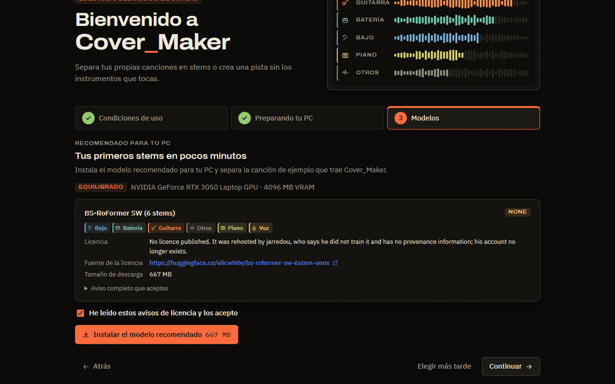
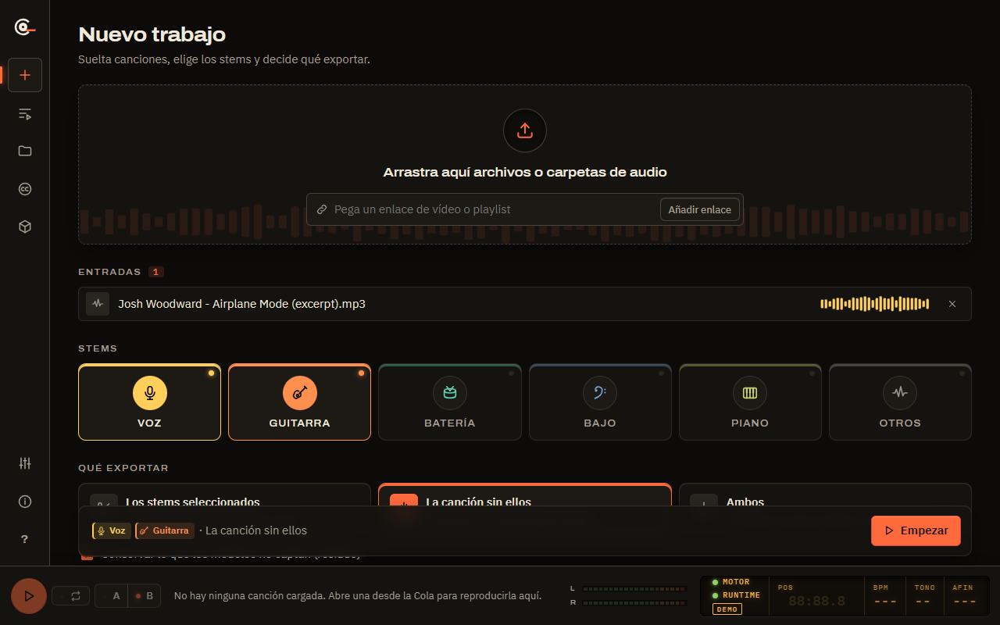
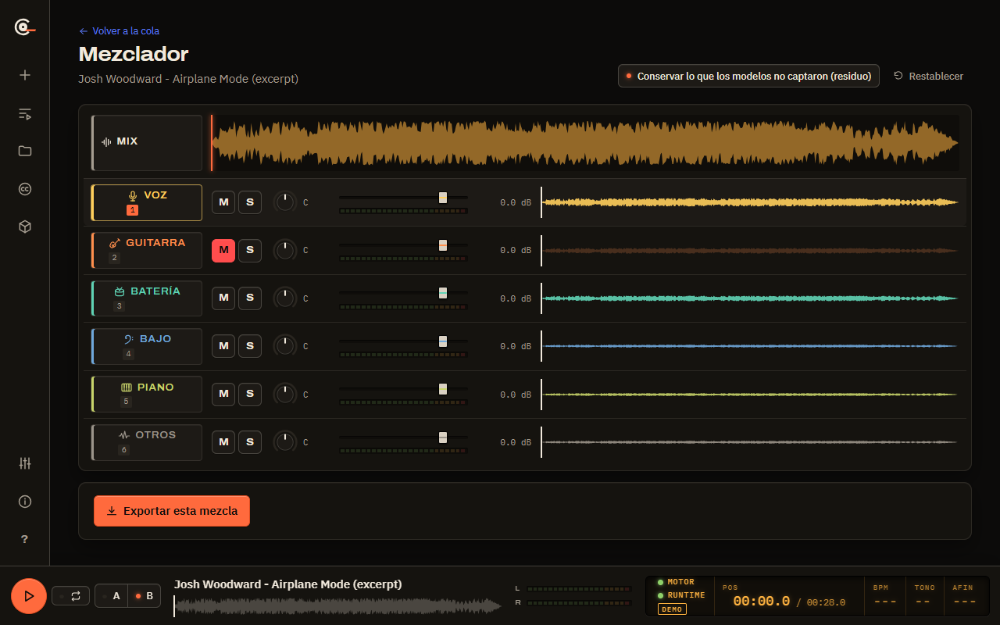
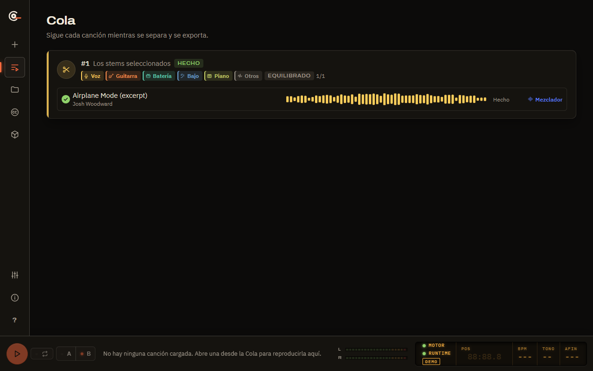
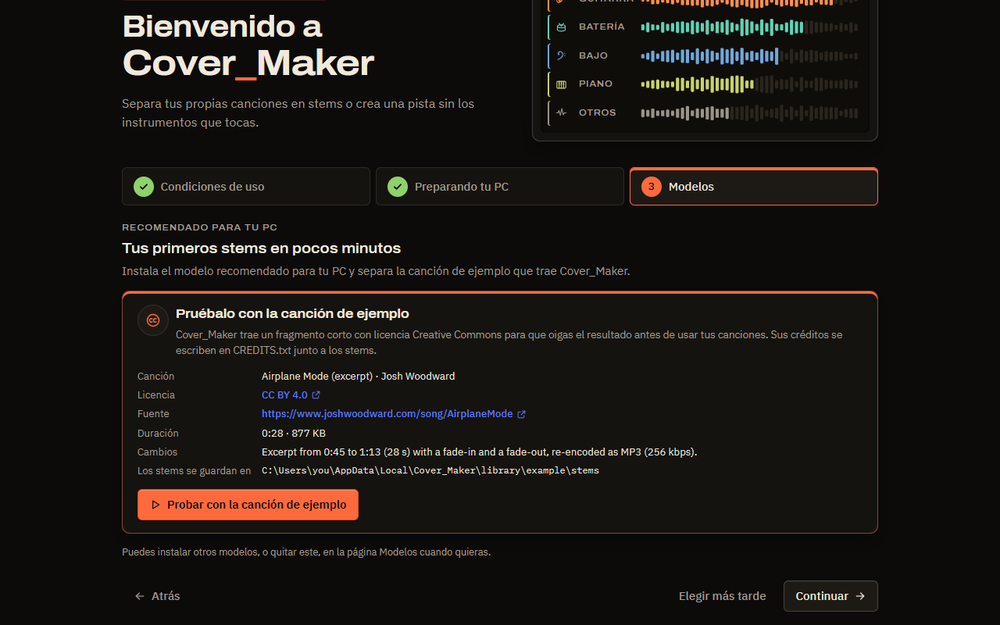

  

<h1 align="center">Cover_Maker</h1>

  <strong>El estudio del músico de covers.</strong> 
  Separa una canción en voz, guitarra, batería, bajo, piano y otros, o crea
  una pista de acompañamiento sin las partes que tocas tú, en tu PC con
  Windows.

  

  
  
  

  

- **Libre y de código abierto.** Licencia MIT, sin versión de pago ni marcas
  de agua.
- **100 % local.** La separación se hace en tu ordenador. Sin cuenta, sin
  telemetría, sin subir nada.
- **En tu idioma.** Toda la aplicación está en español y en inglés.

## Descarga

[**Descarga el instalador para Windows 10/11 (64 bits)**](https://github.com/asanzhuerta/Cover_Maker/releases/latest/download/Cover_Maker_x64-setup.exe).
Al arrancar por primera vez, Cover_Maker descarga su runtime de separación
(menos de 1 GB en la versión para procesador, unos 4 GB con una tarjeta
gráfica NVIDIA; antes de descargar nada te muestra el tamaño exacto) y te
propone el modelo de IA recomendado para tu PC. Acepta su licencia, instálalo
con un clic y prueba la canción de ejemplo que viene incluida: tendrás tus
primeros stems pocos minutos después de instalar.

Más opciones: en la [página de versiones](https://github.com/asanzhuerta/Cover_Maker/releases)
están también el plugin VST3 y el script de REAPER (opcionales), y
[`packaging/`](packaging/README.md) prepara los paquetes de winget y Scoop.
Mientras el instalador no esté firmado, Windows SmartScreen puede avisar de un
editor desconocido; consulta la [política de firma de código](README.md#code-signing-policy).

## Funciones

<table>
  <tr>
    <td width="50%" valign="top">
      
      <strong>Elige stems o quítalos.</strong> Extrae cualquiera de los seis
      stems, o genera la canción «sin X» (por ejemplo sin voz ni guitarra)
      como pista de acompañamiento. Arrastra archivos o carpetas enteras, o
      pega un enlace de vídeo sobre el que tengas derechos.
    </td>
    <td width="50%" valign="top">
      
      <strong>Escúchalo antes de exportar.</strong> Un mezclador de consola
      con formas de onda sincronizadas, mute, solo, panorama, medidores de
      nivel, bucle y un conmutador A/B con el original. Exporta la mezcla que
      oyes.
    </td>
  </tr>
  <tr>
    <td valign="top">
      
      <strong>Lotes y biblioteca.</strong> Una cola de trabajos con progreso
      por canción, pausa y cancelación; las carpetas vigiladas y las listas se
      resincronizan, así que solo se procesan las canciones nuevas o
      cambiadas.
    </td>
    <td valign="top">
      
      <strong>Modelos con transparencia.</strong> Cada modelo de IA muestra su
      licencia y su procedencia antes de descargarlo; Cover_Maker recomienda
      el que encaja con tu equipo y nunca incluye los pesos.
    </td>
  </tr>
</table>

Y además: un catálogo Creative Commons (ccMixter, Internet Archive) que
conserva la atribución en un `CREDITS.txt` junto a tus stems; importación de
listas de reproducción emparejadas con las canciones que ya tienes; un script
de REAPER y un plugin VST3 para llevar los stems directamente a tu DAW; temas
oscuro y claro.

## Por qué Cover_Maker

| | Cover_Maker | Apps de suscripción | Separadores básicos |
|---|---|---|---|
| Precio | Gratis, código abierto | Cuota mensual | Gratis o pago único |
| Dónde va tu audio | Se queda en tu PC | Se sube a un servidor | Normalmente local |
| Cuenta y telemetría | Ninguna | Cuenta obligatoria | Depende |
| Stems | Voz, guitarra, batería, bajo, piano, otros | Muchos | A menudo de 2 a 4 |
| Pista «sin X» | Sí, cualquier combinación | A menudo | Rara vez |
| Mezclador con A/B frente al original | Sí | A menudo | No |
| Lotes, carpetas vigiladas, resincronización | Sí | Limitado | No |
| Licencias de los modelos antes de descargar | Sí | No aplica | Rara vez |
| Integración con DAW (REAPER, VST3) | Sí | Algunas | No |
| Interfaz en español e inglés | Sí | Depende | Depende |

## ¿Qué velocidad tiene?

Tiempo de separación de una canción de 4 minutos, medido en el portátil de
referencia del proyecto (resultados en [`docs/data/benchmarks`](docs/data/benchmarks)):

| Equipo | Preset (modelo) | Tiempo |
|---|---|---|
| NVIDIA RTX 3050 Laptop, 4 GB de VRAM | Equilibrado (BS-RoFormer SW, 6 stems) | unos 80 s |
| NVIDIA RTX 3050 Laptop, 4 GB de VRAM | Rápido (Demucs, 6 stems) | unos 30 s |
| Intel Core i5-11400H, sin GPU | Rápido (Demucs, 6 stems) | unos 2,5 min |

Cover_Maker elige el preset según tu equipo y afina la estimación con tus
propias separaciones.

| | Mínimo | Recomendado |
|---|---|---|
| Sistema | Windows 10/11 de 64 bits | Windows 11 |
| CPU | 4 núcleos / 8 hilos, AVX2 | 6–8 núcleos (2022 o posterior) |
| RAM | 16 GB | 32 GB |
| GPU | Opcional (en CPU es más lento) | NVIDIA RTX con 8 GB de VRAM o más |
| Disco | SSD, 10 GB libres | NVMe, 20 GB libres o más |

## Preguntas frecuentes

**¿Es legal?** Cover_Maker es una herramienta, como un editor de audio: nunca
busca, rastrea ni empareja música en servicios de streaming, y no rompe DRM.
Úsalo con audio que sea tuyo o que puedas usar: tus grabaciones, compras sin
DRM, música Creative Commons. El audio en línea solo se obtiene de enlaces que
pegas tú, después de confirmar que tienes los derechos. Publicar una pista de
acompañamiento hecha a partir de una grabación comercial requiere permiso de
sus titulares. Lee el [aviso legal](DISCLAIMER.md) (en inglés).

**¿Necesito tarjeta gráfica?** No. Sin una GPU NVIDIA, Cover_Maker usa el
preset Rápido en el procesador; una canción de 4 minutos tarda unos pocos
minutos. Una tarjeta NVIDIA con 4 GB de VRAM o más permite los presets
Equilibrado y Máxima calidad.

**¿Qué envía por Internet?** Nada sobre ti ni sobre tu música. Solo descarga
lo que necesita (runtime, modelos, actualizaciones) y lo que tú pides (enlaces
que pegas, búsquedas Creative Commons). Consulta [Privacidad](#privacidad).

**¿Qué modelos usa y con qué licencias?** Modelos de la comunidad como
BS-RoFormer y Demucs, descargados de sus fuentes originales después de que
aceptes sus condiciones. Algunos no publican licencia o la tienen no comercial;
la aplicación te lo dice antes de descargar. Consulta
[MODEL_LICENCES.md](MODEL_LICENCES.md).

## Documentación

La Guía de instalación, el Manual de usuario, la Especificación de requisitos,
la Arquitectura y diseño, el Plan de pruebas y el Plan del proyecto están
escritos en LaTeX (en inglés) en [`docs/latex`](docs/latex) y se adjuntan como
PDF a cada versión. Los cambios se recogen en el [CHANGELOG](CHANGELOG.md).

## Contribuir

Los informes de errores, las ideas y los pull requests son bienvenidos; lee
antes [CONTRIBUTING.md](CONTRIBUTING.md). **Las traducciones son
especialmente bienvenidas:** los textos de la interfaz están en
[`desktop/src/lib/i18n.svelte.ts`](desktop/src/lib/i18n.svelte.ts), un
diccionario por idioma. Ayúdanos a mantener el proyecto legal desde el
diseño: nada de audio comercial en issues, tests ni capturas.

## Créditos

- Modelos de separación: BS-RoFormer SW, BS-RoFormer Resurrection (unwa),
  Mel-Band RoFormer (Kimberley Jensen) y Hybrid Transformer Demucs (Meta AI),
  ejecutados con [python-audio-separator](https://github.com/nomadkaraoke/python-audio-separator)
  y [PyTorch](https://pytorch.org). Licencias y procedencia en
  [MODEL_LICENCES.md](MODEL_LICENCES.md).
- Canción de ejemplo: [«Airplane Mode»](https://www.joshwoodward.com/song/AirplaneMode)
  de Josh Woodward, con licencia
  [CC BY 4.0](https://creativecommons.org/licenses/by/4.0/); la aplicación
  incluye un fragmento de 28 segundos con fundidos.
- Hecho con [Tauri](https://tauri.app), [Svelte](https://svelte.dev),
  [FastAPI](https://fastapi.tiangolo.com), [yt-dlp](https://github.com/yt-dlp/yt-dlp)
  y [ffmpeg](https://ffmpeg.org); fuentes Archivo e IBM Plex (SIL OFL 1.1).
  Todos los componentes de terceros están en
  [THIRD_PARTY_NOTICES.md](THIRD_PARTY_NOTICES.md).

## Legal desde el diseño

Cover_Maker nunca busca, rastrea ni empareja música en servicios de streaming.
El audio en línea solo se obtiene de enlaces que pegas tú, después de
confirmar que tienes derecho a usar ese contenido. Este proyecto nunca incluye
ni aloja pesos de modelos de IA; la licencia de cada modelo se muestra antes de
descargarlo. Las capturas, los tests y los ejemplos usan solo audio sintético o
Creative Commons.

## Privacidad

Cover_Maker no tiene cuentas, ni telemetría, ni analítica: no envía tu audio,
tu biblioteca ni datos de uso a ningún sitio. La separación se hace en tu
ordenador. La aplicación solo se conecta a Internet para:

- **Primera ejecución y reparaciones:** descargar el runtime de separación
  (Python desde GitHub, paquetes desde PyPI y el índice de PyTorch, ffmpeg y
  deno), cada uno fijado por hash.
- **Actualizaciones:** consultar las versiones de este repositorio en GitHub,
  verificadas con la firma de actualización antes de instalarlas.
- **Modelos:** descargar un modelo de IA desde su fuente original (Hugging Face
  o GitHub) cuando lo aceptas.
- **Lo que tú pides:** los enlaces de vídeo o de listas que pegas (con yt-dlp,
  después de confirmar que tienes los derechos), y las búsquedas y descargas
  de la página de fuentes Creative Commons (ccMixter, Internet Archive).

La canción de ejemplo viene dentro de la aplicación, así que probarla no
descarga nada. Esos servicios reciben los datos habituales de cualquier
petición (tu dirección IP y los archivos pedidos) según sus propias políticas
de privacidad. El motor solo escucha en `127.0.0.1`; consulta
[SECURITY.md](SECURITY.md).

## Licencia

[MIT](LICENSE). El plugin VST3 opcional de `daw/vst3` es GPL-3.0-or-later por
sus enlaces VST3. Los componentes de terceros, los modelos de IA y la canción
de ejemplo conservan sus propias licencias: consulta
[THIRD_PARTY_NOTICES.md](THIRD_PARTY_NOTICES.md) y
[MODEL_LICENCES.md](MODEL_LICENCES.md). La política de firma de código está en
el [README en inglés](README.md#code-signing-policy).
