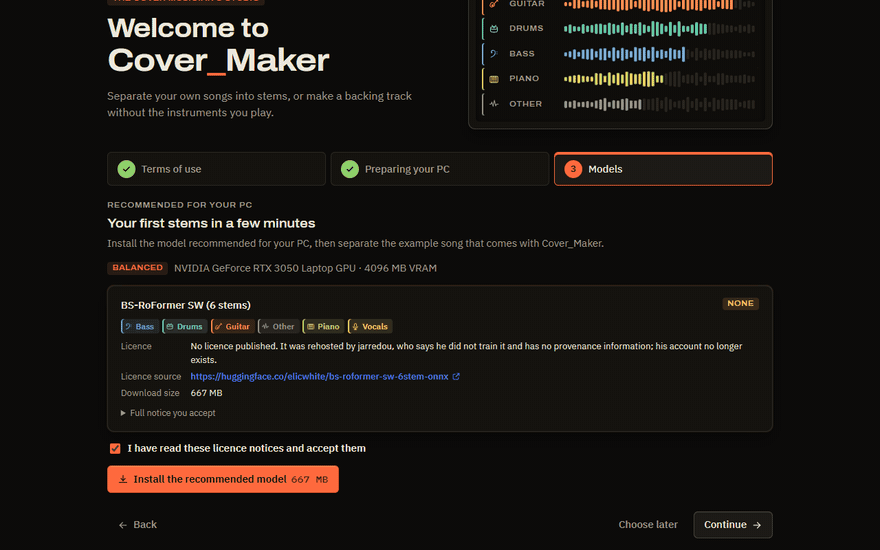
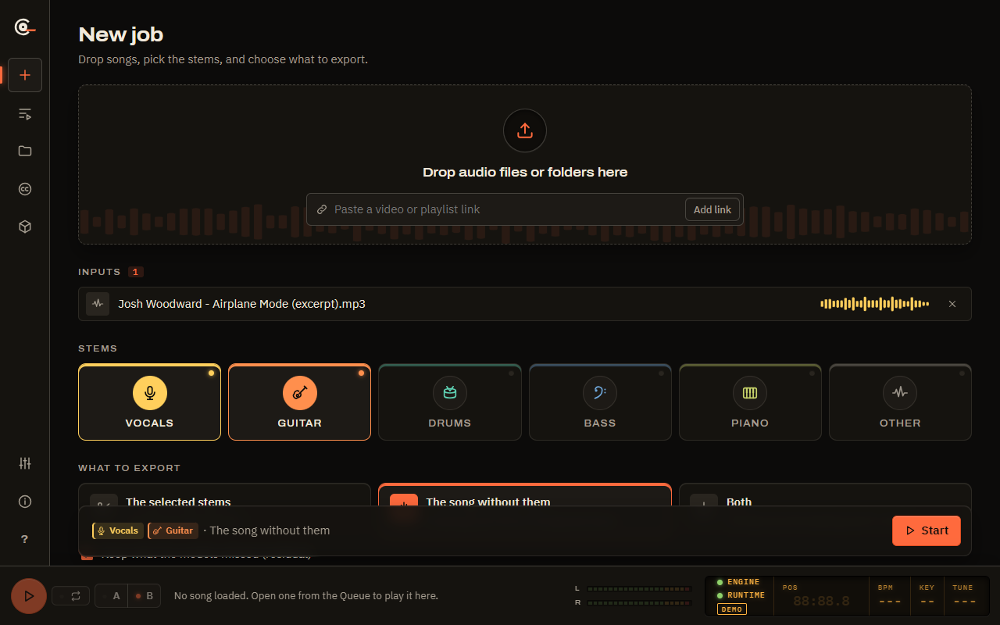
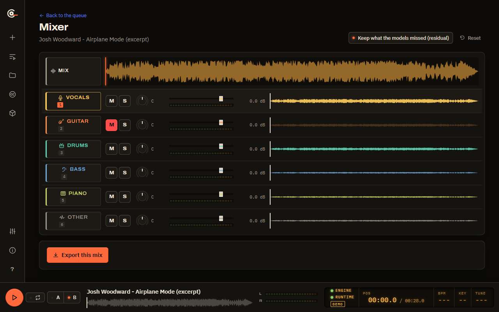
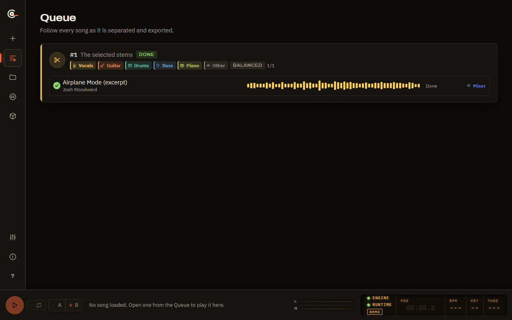
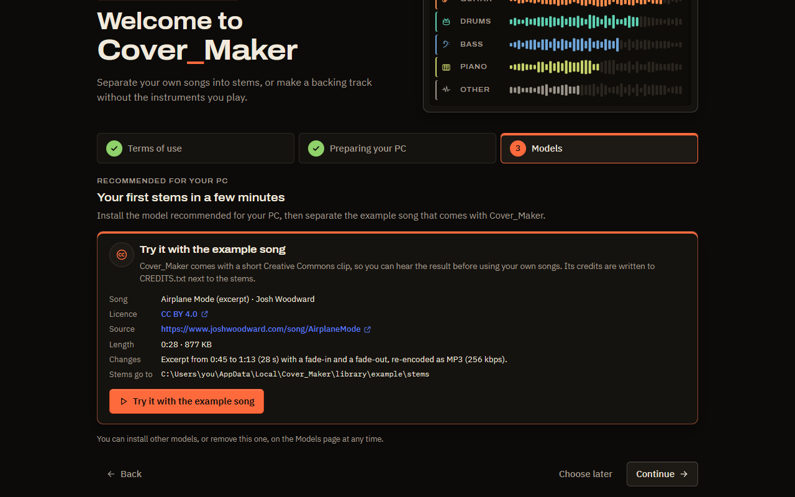

  

<h1 align="center">Cover_Maker</h1>

  <strong>The cover musician's studio.</strong> 
  Split a song into vocals, guitar, drums, bass, piano and other, or make a
  backing track without the parts you play, right on your Windows PC.

  

  
  
  

  

- **Free and open source.** MIT licence, no paid tier, no watermark.
- **100 % local.** Separation runs on your computer. No account, no
  telemetry, no uploads.
- **In your language.** The whole app speaks English and Spanish.

## Download

[**Download the installer for Windows 10/11 (64-bit)**](https://github.com/asanzhuerta/Cover_Maker/releases/latest/download/Cover_Maker_x64-setup.exe).
On first start Cover_Maker downloads its separation runtime (under 1 GB for
the processor build, about 4 GB with an NVIDIA graphics card; the exact size is
shown before anything is downloaded) and shows the AI model recommended for
your PC. Accept its licence, install it with one click and try the bundled example
song: your first stems are ready a few minutes after setup.

Other options: the [Releases page](https://github.com/asanzhuerta/Cover_Maker/releases)
also has the optional VST3 plugin and REAPER script, and
[`packaging/`](packaging/README.md) prepares winget and Scoop packages. Until
the installer is code-signed, Windows SmartScreen may warn about an unknown
publisher; see the [code signing policy](#code-signing-policy).

## Features

<table>
  <tr>
    <td width="50%" valign="top">
      
      <strong>Pick stems or remove them.</strong> Extract any of six stems, or
      render the song "without X" (for example without vocals and guitar) as a
      backing track. Drop files or whole folders, or paste a video link you
      have the rights to.
    </td>
    <td width="50%" valign="top">
      
      <strong>Hear it before you export.</strong> A console-style mixer with
      synced waveforms, mute, solo, pan, level meters, loop and an A/B switch
      against the original. Export the mix you hear.
    </td>
  </tr>
  <tr>
    <td valign="top">
      
      <strong>Batch and library.</strong> A job queue with per-song progress,
      pause and cancel; watched folders and playlists re-sync, so only new or
      changed songs are processed again.
    </td>
    <td valign="top">
      
      <strong>Honest models.</strong> Each AI model shows its licence and
      provenance before you download it; Cover_Maker recommends the one that
      fits your hardware and never bundles separation weights.
    </td>
  </tr>
</table>

Also: a Creative Commons catalogue (ccMixter, Internet Archive) that keeps
attribution in a `CREDITS.txt` next to your stems; import of playlist files
matched against the songs you own; a REAPER script and a VST3 plugin to put
stems straight into your DAW; dark and light themes.

## Why Cover_Maker

| | Cover_Maker | Subscription apps | Basic splitters |
|---|---|---|---|
| Price | Free, open source | Monthly fee | Free or one-off |
| Where your audio goes | Stays on your PC | Uploaded to a server | Usually local |
| Account and telemetry | None | Account required | Varies |
| Stems | Vocals, guitar, drums, bass, piano, other | Many | Often 2 to 4 |
| Backing track "without X" | Yes, any combination | Often | Rarely |
| Mixer with A/B against the original | Yes | Often | No |
| Batch, watched folders, re-sync | Yes | Limited | No |
| Model licences shown before download | Yes | Not applicable | Rarely |
| DAW integration (REAPER, VST3) | Yes | Some | No |
| Interface in English and Spanish | Yes | Varies | Varies |

## How fast is it?

Separation time for a 4-minute song, measured on the project's reference
laptop (raw results in [`docs/data/benchmarks`](docs/data/benchmarks)):

| Hardware | Quality preset (model) | Time |
|---|---|---|
| NVIDIA RTX 3050 Laptop, 4 GB VRAM | Balanced (BS-RoFormer SW, 6 stems) | about 80 s |
| NVIDIA RTX 3050 Laptop, 4 GB VRAM | Fast (Demucs, 6 stems) | about 30 s |
| Intel Core i5-11400H, no GPU | Fast (Demucs, 6 stems) | about 2.5 min |

Cover_Maker picks the preset for your hardware and refines the estimate with
your own runs.

| | Minimum | Recommended |
|---|---|---|
| OS | Windows 10/11 64-bit | Windows 11 |
| CPU | 4 cores / 8 threads, AVX2 | 6–8 cores (2022 or newer) |
| RAM | 16 GB | 32 GB |
| GPU | Optional (CPU mode is slower) | NVIDIA RTX with 8 GB VRAM or more |
| Disk | SSD, 10 GB free | NVMe, 20 GB free or more |

## FAQ

**Is it legal?** Cover_Maker is a tool, like an audio editor: it never
searches for, scrapes or matches music on streaming services, and it does not
break DRM. Use it on audio you own or may use: your recordings, DRM-free
purchases, Creative Commons music. Online audio is fetched only from links you
paste, after you confirm you have the rights. Publishing a backing track made
from a commercial recording needs permission from its rights holders. Read the
[disclaimer](DISCLAIMER.md).

**Do I need a graphics card?** No. Without an NVIDIA GPU, Cover_Maker uses the
Fast preset on the processor; a 4-minute song takes a few minutes. An NVIDIA
card with 4 GB of VRAM or more unlocks the Balanced and Max quality presets.

**What does it send over the Internet?** Nothing about you or your music.
It only downloads what it needs (runtime, models, updates) and what you ask for
(pasted links, Creative Commons searches). See [Privacy](#privacy).

**Which models does it use, and under which licences?** Community models such
as BS-RoFormer and Demucs, downloaded from their original sources after you
accept their terms. Some have no published licence or a non-commercial one;
the app tells you before you download. See [MODEL_LICENCES.md](MODEL_LICENCES.md).

## Documentation

The Installation Guide, User Manual, Software Requirements Specification,
Architecture & Design, Test Plan and Project Plan are written in LaTeX under
[`docs/latex`](docs/latex) and attached as PDFs to each release. Changes are
listed in the [CHANGELOG](CHANGELOG.md).

## Contributing

Bug reports, ideas and pull requests are welcome; read
[CONTRIBUTING.md](CONTRIBUTING.md) first. **Translations are especially
welcome:** the interface strings live in
[`desktop/src/lib/i18n.svelte.ts`](desktop/src/lib/i18n.svelte.ts), one
dictionary per language. Please keep the project legal by design: no
commercial audio in issues, tests or screenshots.

## Credits

- Separation models: BS-RoFormer SW, BS-RoFormer Resurrection (unwa),
  Mel-Band RoFormer (Kimberley Jensen) and Hybrid Transformer Demucs (Meta
  AI), run through [python-audio-separator](https://github.com/nomadkaraoke/python-audio-separator)
  and [PyTorch](https://pytorch.org). Licences and provenance in
  [MODEL_LICENCES.md](MODEL_LICENCES.md).
- Example song: ["Airplane Mode"](https://www.joshwoodward.com/song/AirplaneMode)
  by Josh Woodward, licensed under
  [CC BY 4.0](https://creativecommons.org/licenses/by/4.0/); the app ships a
  28-second excerpt with fades.
- Built with [Tauri](https://tauri.app), [Svelte](https://svelte.dev),
  [FastAPI](https://fastapi.tiangolo.com), [yt-dlp](https://github.com/yt-dlp/yt-dlp)
  and [ffmpeg](https://ffmpeg.org); fonts Archivo and IBM Plex (SIL OFL 1.1).
  Every third-party component is listed in
  [THIRD_PARTY_NOTICES.md](THIRD_PARTY_NOTICES.md).

## Legal by design

Cover_Maker never searches for, scrapes or matches music on streaming
services. Online audio is fetched only from links you paste yourself, after you
confirm you have the right to use that content. Separation model weights are
never bundled or hosted by this project; each model's licence is shown before
you download it. The only bundled model is Basic Pitch's 230 KB
note-transcription model (Apache-2.0), for audio to MIDI. Screenshots, tests and examples use only synthetic or Creative
Commons audio. Read [DISCLAIMER.md](DISCLAIMER.md).

## Code signing policy

Windows releases are built from this repository by GitHub Actions
([`release.yml`](.github/workflows/release.yml)) and are meant to be signed
with an Authenticode certificate through the SignPath Foundation's free code
signing programme for open-source projects. Until the project is accepted, the
installer is unsigned and Windows SmartScreen may warn about an unknown
publisher. Once approved, this section will read: *Free code signing provided
by [SignPath.io](https://about.signpath.io), certificate by
[SignPath Foundation](https://signpath.org).*

Only binaries built from this repository's source by the release workflow are
signed: the installer, the Cover_Maker app and its uninstaller, and the VST3
plugin. Third-party programs that the app downloads (uv, Python, ffmpeg, deno,
Python packages) keep their publishers' own signatures and are verified by
SHA-256 hash before use.

Team roles:

- Committers and reviewers: [asanzhuerta](https://github.com/asanzhuerta)
  (owner). Changes from other contributors are reviewed by the owner before
  they are merged.
- Approvers: [asanzhuerta](https://github.com/asanzhuerta). Every release
  signing request is approved manually.

All team members use multi-factor authentication for GitHub and SignPath.

## Privacy

Cover_Maker has no accounts, no telemetry and no analytics: it does not send
your audio, your library or usage data anywhere. Separation runs on your
computer. The app connects to the Internet only for:

- **First run and repairs:** downloading the separation runtime (Python from
  GitHub, packages from PyPI and the PyTorch index, ffmpeg and deno), each
  pinned by hash.
- **Updates:** checking this repository's GitHub Releases for a new version,
  verified by the update signature before it is installed.
- **Models:** downloading an AI model from its original source (Hugging Face
  or GitHub) when you accept it.
- **What you ask for:** the video or playlist links you paste (through
  yt-dlp, after you confirm you have the rights), and searches and downloads
  on the Creative Commons sources page (ccMixter, Internet Archive).

The example song ships inside the app, so trying it needs no download. The
services above receive the usual request data (your IP address and the files
requested) under their own privacy policies. The engine listens only on
`127.0.0.1`; see [SECURITY.md](SECURITY.md).

## Licence

[MIT](LICENSE). The optional VST3 plugin in `daw/vst3` is GPL-3.0-or-later
because of its VST3 bindings. Third-party components, AI models and the
example song keep their own licences: see
[THIRD_PARTY_NOTICES.md](THIRD_PARTY_NOTICES.md) and
[MODEL_LICENCES.md](MODEL_LICENCES.md).
